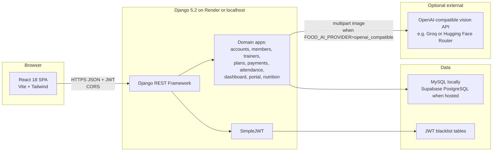
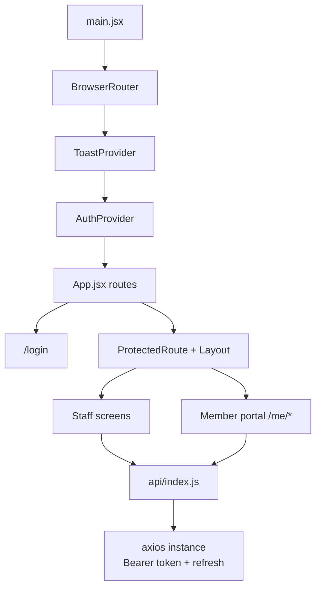
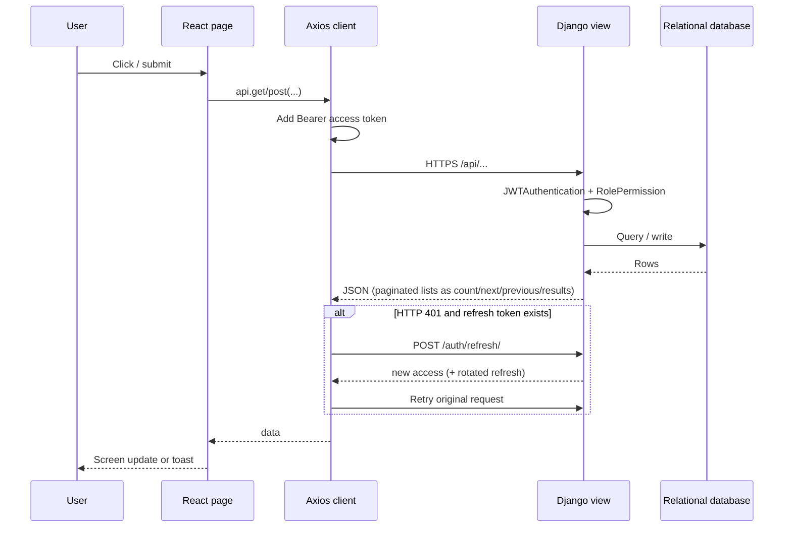
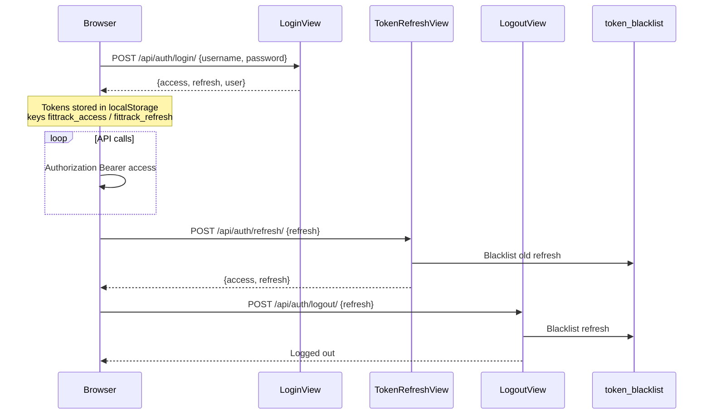
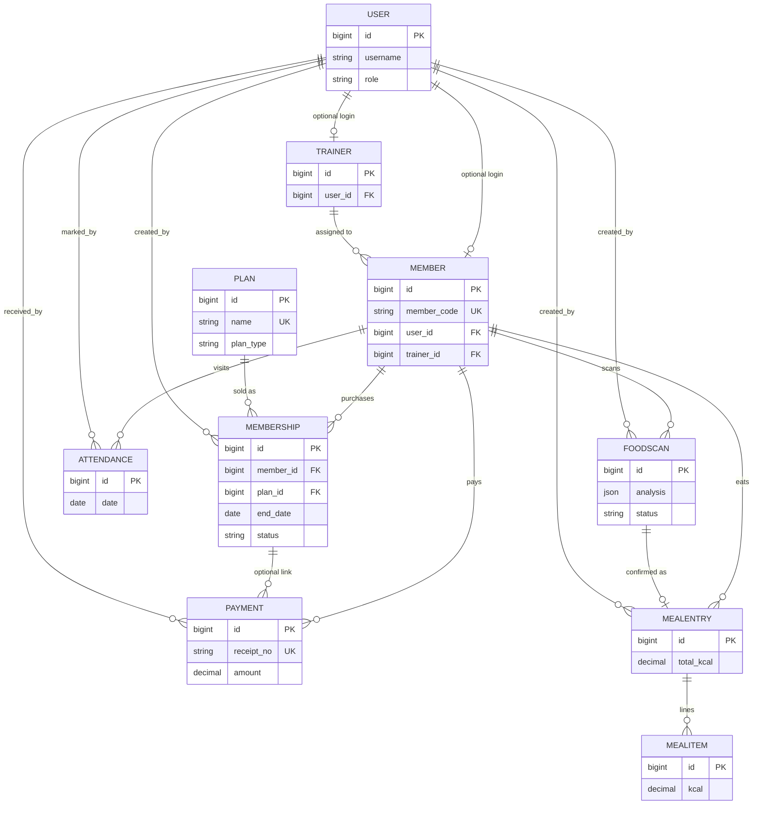
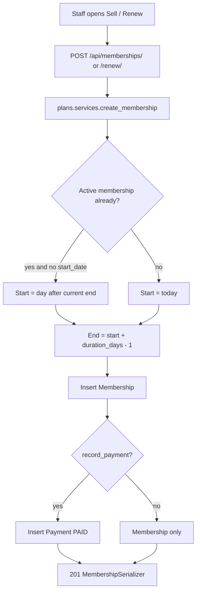
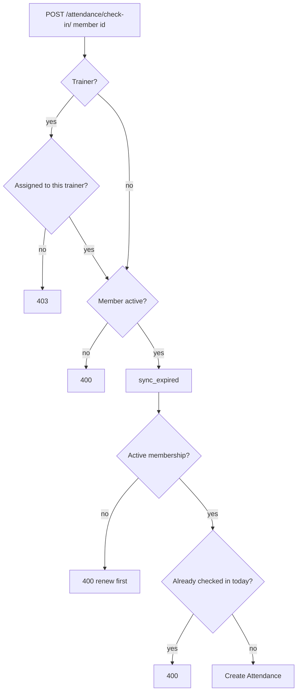
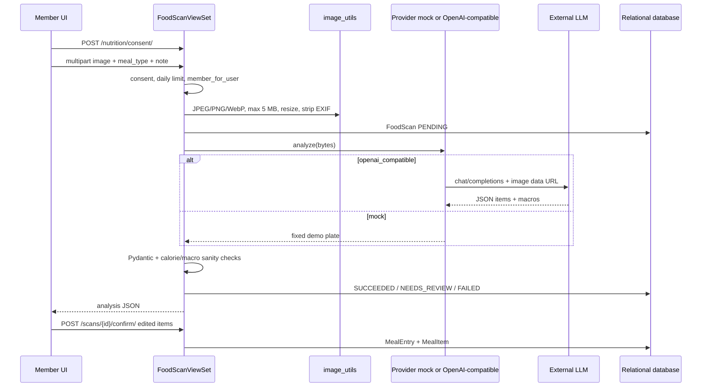
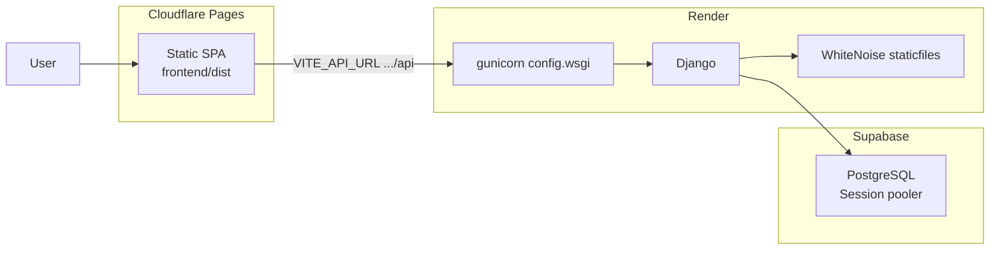

# FitTrack – System Architecture

This document describes the architecture that is implemented in the repository. It complements [FITTRACK_TECHNICAL_DOCUMENTATION.md](./FITTRACK_TECHNICAL_DOCUMENTATION.md).

---

## 1. High-level system architecture

FitTrack is a **split web application**: a React single-page app talks to a Django REST API. The API stores gym data in a relational database: MySQL is the local-development default, and PostgreSQL is supported for Supabase hosting. Authentication uses **JWT** (access + refresh). Food photo analysis is optional and calls an **OpenAI-compatible vision LLM** (or a local mock).

**In simple language:** the gym staff and members use a website. The website never talks to the database itself. It asks the Django API. The API checks who is logged in, applies role rules, then reads or writes the database. For a meal photo, the API shrinks the image, sends it to a vision model, validates the JSON, and only then lets the member save a meal.

**Verified from:** `frontend/src/api/client.js`, `backend/config/settings.py`, `backend/config/urls.py`, `backend/nutrition/ai/registry.py`, `render.yaml`.

---

## 2. Frontend architecture

- **Routing:** `frontend/src/App.jsx` with React Router v6.
- **Auth state:** `AuthContext` loads `/auth/me/` if an access token exists in `localStorage`.
- **HTTP:** one Axios instance (`frontend/src/api/client.js`) attaches `Authorization: Bearer …` and retries once after `POST /auth/refresh/`.
- **UI:** Tailwind “ink” (near-black) + “brand” (orange). Charts use Recharts on Dashboard, Attendance reports, and member Food log.

Members and staff share the same SPA. After login, `HomeRedirect` sends `MEMBER` to `/me` and everyone else to the staff dashboard.

---

## 3. Backend architecture

Django project package: `backend/config/` (`settings.py`, `urls.py`, `wsgi.py`).

| App | Role in architecture |
|---|---|
| `core` | Permissions, pagination, exception handler, `seed_data`, `update_membership_status`, health helper |
| `accounts` | Custom `User` with `role`, JWT login/logout, admin user CRUD |
| `members` | Member master data + optional member login |
| `trainers` | Trainer master data + optional trainer login + assign members |
| `plans` | Plans and memberships (sell / renew / cancel) |
| `payments` | Manual payment **records** and printable receipt JSON (not a payment gateway) |
| `attendance` | Check-in / check-out / reports |
| `dashboard` | Aggregated stats for staff/trainers |
| `portal` | Member self-service reads (profile, memberships, visits) |
| `nutrition` | Food scans, meal diary, vision providers |

Requests enter `config/urls.py` under `/api/` (except Django admin at `/admin/`).

---

## 4. Frontend-to-backend request flow

List endpoints use `core.pagination.StandardPagination` (`page`, `page_size` up to 100, default 10).

---

## 5. Authentication and JWT flow

Configured in `backend/config/settings.py` (`SIMPLE_JWT`):

- Access lifetime: `ACCESS_TOKEN_MINUTES` (default **30**).
- Refresh lifetime: `REFRESH_TOKEN_DAYS` (default **7**).
- `ROTATE_REFRESH_TOKENS = True`
- `BLACKLIST_AFTER_ROTATION = True`
- `UPDATE_LAST_LOGIN = True`

Login uses `FitTrackTokenSerializer`, which adds `role` and `username` into the JWT payload and returns a `user` object (including `member_id` for member accounts).

**Limitation:** tokens live in `localStorage` (XSS-accessible). There is no httpOnly cookie session for the SPA.

---

## 6. Database relationships

Django table names follow `app_model` (for example `members_member`, `plans_membership`, `nutrition_foodscan`). Custom user table is `accounts_user`. SimpleJWT blacklist tables are created by `rest_framework_simplejwt.token_blacklist`.

**How the gym domain connects:**

1. A **Member** is the person who trains. They may have a login (`User.role = MEMBER`).
2. A **Trainer** may have a login (`User.role = TRAINER`). Members optionally point at one trainer.
3. A **Membership** is one sold period of a **MembershipPlan**. Renewals create a **new** membership row.
4. A **Payment** is a desk-recorded amount (cash, UPI, card, bank transfer). It may point at a membership. Members with payments cannot be hard-deleted (`on_delete=PROTECT`).
5. **Attendance** is one visit per member per day (`unique_attendance_per_member_per_day`).
6. **FoodScan** holds model JSON, not the photo. Confirming a scan creates **MealEntry** + **MealItem** rows.

---

## 7. Main business workflows

### 7.1 Sell or renew a membership

### 7.2 Check-in

### 7.3 Food photo scan (member)

Photos are **not** stored as files after analysis (`FoodScan` has no `ImageField`). The UI disclaimer in `FoodLog.jsx` states this.

---

## 8. Deployment architecture

**Verified from:** `render.yaml` (Python 3.12.7, `bash build.sh`, health `/api/health/`), `backend/build.sh` (collectstatic, migrate, optional `seed_data`), Cloudflare Pages build settings and `frontend/public/_redirects` (SPA fallback to `index.html`).

The Render blueprint uses Supabase PostgreSQL through its Session pooler with SSL required. Operators provide the pooler `DB_*` credentials. Local development continues to default to MySQL.

Default production food AI in `render.yaml` is `FOOD_AI_PROVIDER=mock` unless an operator sets a real key.

---

## 9. External services (as implemented)

| Service | Required? | Where configured |
|---|---|---|
| Supabase PostgreSQL | Hosted deployment | `DB_ENGINE=postgresql`, `DB_*`, `DB_SSLMODE=require` |
| MySQL | Local-development default | `DB_ENGINE=mysql`, `DB_*` |
| Vision LLM | No (mock works) | `FOOD_AI_*` |
| Render | Optional hosting | `render.yaml` |
| Cloudflare Pages | Recommended SPA hosting | Pages build settings, `frontend/public/_redirects` |
| Vercel | Optional alternative SPA hosting | `frontend/vercel.json` |

There is **no** Stripe, Razorpay, or other payment processor in the codebase. Payments are staff-entered records.

There is **no** dedicated nutrition food composition database (USDA, IFCT, etc.). Macros come from the LLM (or mock) and are summed in `nutrition/services.py`.
